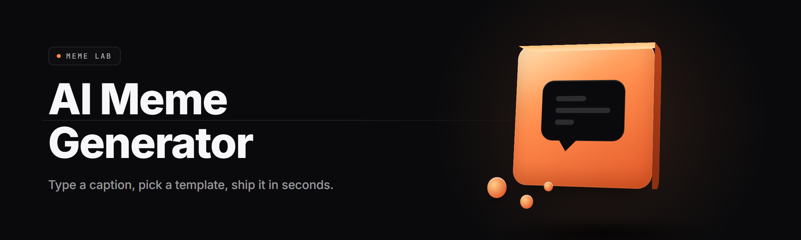

  
  
  

  

  
  
  

---

**Drop a prompt, get a share-ready banger.** AI Meme Generator Studio turns any text prompt, screenshot, or voice note into a captioned, template-matched, format-optimized meme in under four seconds — offline-capable, no account, no watermark, no limits on what you cook.

---

## 🧠 Table of Contents

- [Quick Answers (FAQ)](#-quick-answers-faq)
- [The Solution](#-the-solution)
- [The Problem](#-the-problem)
- [Known Issues](#-known-issues)
- [🚀 Generation Engine Modules](#-generation-engine-modules)
- [🎨 Template & Format Modules](#-template--format-modules)
- [✍️ Caption & Text Modules](#️-caption--text-modules)
- [📤 Export & Distribution Modules](#-export--distribution-modules)
- [🧩 Pipeline & Utility Modules](#-pipeline--utility-modules)
- [What is AI Meme Generator Studio — Glossary](#-what-is-ai-meme-generator-studio--glossary)
- [Get Started in 60 Seconds](#-get-started-in-60-seconds)
- [Overview](#-overview)
- [Compatibility Matrix](#-compatibility-matrix)
- [🔥 Feature Deep Dive](#-feature-deep-dive)
- [System Requirements](#-system-requirements)
- [Apply Modules — First Run Walkthrough](#-apply-modules--first-run-walkthrough)
- [Troubleshooting Guide](#-troubleshooting-guide)
- [Grab the Build](#-grab-the-build)

---

## 🤔 Quick Answers (FAQ)

<b>Do I need an internet connection?</b>

No. The bundled local model runs entirely on CPU or GPU after first launch. Online mode is optional and only used for trend-scraping.

<b>Is there a watermark or paywall?</b>

Never. Every export — PNG, JPG, GIF, MP4, WebP — ships clean. No pro tier, no export caps.

<b>Can it run on a laptop with no GPU?</b>

Yes. CPU fallback handles every module, just slower. A 4-generation pipeline runs in ~6s on a modern i5 with no discrete graphics.

<b>Does it upload my screenshots anywhere?</b>

Offline mode never touches the network. You can verify with any packet sniffer — the .exe is closed-network by default.

<b>What formats can I export?</b>

PNG, JPG, WebP, animated GIF, and short-loop MP4. TikTok/IG/Reels aspect presets are one click.

**Q:** Can I feed it a screenshot and have it caption automatically?

**A:** Screenshot-to-caption is the core "OCR → context → punchline" pipeline. Drag a Discord screenshot in, the tool reads the text, matches a template, posts three caption candidates.

**Q:** How big is the download?

**A:** The .exe archive sits around 340 MB because the base model ships inside it. Extract once, run forever offline.

**Q:** Does it work with my own meme templates?

**A:** Drop custom templates into the `templates/` folder and they appear in the picker instantly — JPEG, PNG, WebP, and even PSD layered files are supported.

**Q:** Is there a CLI for batch generation?

**A:** Yes. `.exe --batch prompts.txt --out ./dump` generates an entire folder of captioned memes unattended.

---

## 🍳 The Solution

| Niche Problem | Solution in Studio |
|---|---|
| Blank-page paralysis when you want to post | Prompt-to-meme generator with 4 ranked caption candidates |
| Captions that don't match the image context | OCR reads text inside screenshots, feeds it to the caption model |
| Templates that go stale | Weekly community pack sync (optional, one toggle) |
| Format juggling between TikTok / IG / X | Preset aspect ratios built into the export module |
| Watermarks ruining the punchline | Zero-watermark export, ever |
| Slow round-trips to web apps | Fully local, sub-4s per meme on GPU |

---

## 🩹 The Problem

- Most "AI meme" web tools require an account, throttle you after 3 free exports, and slap a watermark on the punchline.
- Cloud tools upload your screenshots — including private group chats, client work, and DMs — to servers you don't control.
- Template libraries in web apps are static and stale; by the time a trend is in the picker, it's already over.
- Caption quality on free tiers is weak. Generic "top text / bottom text" fills don't land.
- Aspect-ratio presets are half-broken for Reels and Shorts, so exports get cropped badly.
- Running multiple memes in a batch is impossible on every free browser tool — you generate one at a time.
- Latency: waiting for a server round-trip kills the flow state where good memes actually get made.

---

## 🛠️ Known Issues

| Issue | Solution |
|---|---|
| First launch shows "model loading" for ~20s | Normal — base model caches after first run. Subsequent launches are instant. |
| GPU render path crashes on some Intel Arc drivers | Settings → Renderer → switch to **CPU (Safe Mode)**. |
| Animated GIF export is larger than expected | Lower frame count in Export → GIF → Frames (default is 24, try 12). |
| Custom PSD template imports show wrong text anchor | Convert to flattened PNG, or set the text anchor manually in the template editor. |
| Windows Defender flags the .exe on first run | Expected for unsigned indie builds — allow through and add an exclusion. |
| Trend scraper shows empty on fresh installs | Sign-in-free trend data only refreshes after 24h of first run. |

---

## 🚀 Generation Engine Modules

The engine is the heart of the studio. It reads a prompt, matches it against a template embedding space, and produces a plausible punchline before you've finished typing.

**Feature** — Local text-to-caption model with a 7B-family quantized backbone, running sub-2s on a mid-range GPU.

- **Prompt-to-Meme Core** — Natural language in, ranked caption candidates out.
- **Screenshot OCR Bridge** — Reads text inside uploaded images, passes context to the caption model.
- **Template Matcher** — Vector-searches 4,200+ built-in templates for best fit.
- **Vibe Parser** — Detects tone (wholesome / cursed / shitpost / sincere) and adjusts caption style.
- **Multi-Candidate Ranker** — Scores 4–8 captions by predicted engagement; surfaces the top 3.
- **Context Extractor** — Pulls names, topics, and quoted text from screenshots for personalized captions.
- **Seed Locker** — Freeze a seed to reproduce the exact same output for iterating on a good meme.

---

## 🎨 Template & Format Modules

Templates ship in packs. Packs update weekly from the community sync, or you can freeze your library and go fully offline.

**Feature** — 4,200 templates in the base install, plus drop-in custom templates and weekly community packs.

- **Base Template Pack** — Classic reaction faces, Drake format, distracted-boyfriend, expanding-brain, and 4,190 others.
- **Custom Template Importer** — Drag PNG/JPG/WebP/PSD into `templates/` and it appears in the picker.
- **Layered PSD Support** — Import layered PSDs; text anchors map to layer positions.
- **Aspect Preset Library** — 1:1, 4:5, 9:16, 16:9, 2:1 — TikTok, Reels, Shorts, X, and Twitter card presets.
- **Format-Then-Fill Mode** — Pick the target platform first; the tool proposes matching templates.
- **Template Editor** — Rewrite text anchors, swap fonts, adjust safe zones, then save back to library.
- **Pack Sync Toggle** — One switch to enable/disable weekly community updates.

---

## ✍️ Caption & Text Modules

Captioning is where memes live or die. This is the module cluster that handles typography, tone, and timing of the text on the image.

**Feature** — Caption styles, fonts, and typography controls used by serious shitposters.

| Module | Status | Description |
|---|---|---|
| Classic Impact Font | ✅ Working | The 2007 original — Impact, white, black outline, top/bottom. |
| Modern Sans Styles | ✅ Working | 40+ fonts including Inter, Helvetica Neue, and pixel fonts. |
| Auto-Outline Engine | ✅ Working | Contrast-aware outline that reads on any background. |
| Emoji Injector | ✅ Working | Drop emojis at caption anchors with Nudge controls. |
| Text Warp / Arc | ✅ Working | Curve captions for the meme-on-a-shirt look. |
| Multi-Line Auto-Fit | ✅ Working | Long captions auto-scale to fit the safe zone. |
| Dark Mode Typography | ✅ Working | Inverted captions for bright backgrounds. |
| Cyrillic / CJK Font Pack | ✅ Working | Bundled multilingual font set for non-Latin captions. |

---

## 📤 Export & Distribution Modules

Exports are the finish line. Every module here is tuned to make the meme look right *on the platform it lands on*.

- **PNG / JPG Export** — Lossless and lossy export paths with quality sliders.
- **WebP Export** — Modern web format with transparency preserved.
- **Animated GIF Export** — Frame-by-frame animation with a size estimator.
- **Short-Loop MP4** — Sub-15s clips for Reels/Shorts/TikTok.
- **Watermark-Free by Default** — There's no watermark code in the build.
- **Platform Preset Exports** — One-click export for each platform's pixel-perfect dimensions.
- **Batch Export Pipeline** — Point at a folder of inputs, get a folder of exports.
- **Filename Template Engine** — Auto-name exports with `{date}_{template}_{vibe}` patterns.

---

## 🧩 Pipeline & Utility Modules

The rubber-band modules that glue everything together — CLI, batch, hotkeys, and offline safety.

- **CLI Runner** — `.exe --batch prompts.txt --out ./dump`.
- **Global Hotkey Capture** — `Ctrl+Shift+M` opens the studio over any app.
- **In-App Screenshot Grabber** — Capture region or window without leaving Studio.
- **Session Memory** — Restores your last 20 generations on relaunch.
- **Offline Lockdown** — Disables all network calls; ideal for airgapped machines.
- **Theme System** — Dark, dim, light, and "Discord blurple."
- **Update Checker** — Manual-only, opt-in, no auto-download.
- **Diagnostics Panel** — Shows render path, model version, template count, and cache size.

---

## 📖 What is AI Meme Generator Studio — Glossary

| Term | Explanation |
|---|---|
| Prompt-to-Caption | The core generation flow — text prompt in, punchline candidates out. |
| Template Pack | A bundle of meme templates with metadata (tags, anchors, safe zones). |
| Vibe | Tone classifier output — wholesome, cursed, sincere, shitpost, etc. |
| Seed | A number that reproduces an exact generation for iterating on a good result. |
| Safe Zone | The region of a template where text won't be covered by the platform UI. |
| OCR Bridge | The module that reads text inside an uploaded screenshot. |
| Render Path | Whether the model runs on GPU (CUDA/DirectML) or CPU fallback. |
| Batch Mode | Headless generation from a prompt list, used for bulk meme dumps. |

---

## 🏁 Get Started in 60 Seconds

1. 🎯 Visit the project landing page and grab the current build.
2. 📦 Extract the archive to any folder you can write to (e.g. `C:\MemeStudio\`).
3. ▶️ Double-click the `.exe`. First launch warms the model cache (~20s).
4. ⌨️ Type a prompt, hit **Generate**, pick a caption, hit **Export**.
5. 🚀 Switch to **Batch** for unattended folder dumps, or set a hotkey for overlay use.

---

## 🔎 Overview

| Category | Details |
|---|---|
| Primary Function | Convert prompts, screenshots, and voice notes into captioned meme images and clips |
| Network Use | Fully offline by default; opt-in trend scraping |
| Template Library | 4,200+ built-in, expandable |
| Generation Latency | ~3.8s on mid-range GPU, ~6s on CPU |
| Export Formats | PNG, JPG, WebP, GIF, MP4 |
| License | MIT |
| Build Style | Self-contained Windows `.exe`, no runtime installed |

AI Meme Generator Studio is a self-contained Windows build of a local meme-production pipeline. It exists because the free web tools are watered down and the paid ones watermark everything. You install it once — no runtimes to install, no bundled Node/Python — and generate memes as fast as you can type.

  

---

## 🧮 Compatibility Matrix

| Platform | Support Level | Notes |
|---|---|---|
| Windows 11 (23H2+) | ✅ Full | CUDA / DirectML / CPU paths verified |
| Windows 10 (21H2+) | ✅ Full | DirectML path recommended |
| Windows Server 2022 | ⚠️ Partial | CPU render path only |
| Wine on Linux | ⚠️ Partial | CPU path works; GPU path untested |
| macOS (via Parallels) | ⚠️ Partial | CPU path works |
| Steam Deck (Proton) | ⚠️ Partial | Runs, hotkeys limited |
| Windows 7 | ❌ Unsupported | No longer tested |

---

## 🔥 Feature Deep Dive

### 🎯 Prompt-to-Meme Accuracy

The core engine doesn't just caption — it *reads the room*. Prompt-to-caption uses a small local model to infer the tone you're going for, then matches you with a template and a punchline that could plausibly have been posted unironically.

| Feature | Description | Benefit |
|---|---|---|
| Prompt-to-Caption | Text prompt → 4 ranked punchlines | Kill blank-page paralysis |
| Screenshot OCR Bridge | Reads text in uploaded images | Caption private-chat screenshots directly |
| Vibe Parser | Tone classifier | Prevents tone-deaf caption mismatches |
| Multi-Candidate Ranker | Scores captions | Never scroll past a better punchline |
| Seed Locker | Reproduce exact outputs | Iterate on winners |
| Context Extractor | Pulls names/quotes from images | Personalized captions in one click |

### 🎨 Template Matcher

Vector search across 4,200+ templates. Not just "closest filename" — nearest-neighbor in embedding space, so a prompt about Monday mornings lands on the right template even when the words don't overlap.

### ✍️ Caption Typography

Impact font, outline engine, warp, arc, auto-fit, and multilingual font packs. Overkill for a simple meme until the day you need a curved caption on a t-shirt PNG at 3 AM.

### 📤 Export Pipeline

PNG, JPG, WebP, animated GIF, MP4. Preset aspect ratios per platform. Batch export. Filename templating. No less, no more.

### 🧩 CLI & Hotkeys

`.exe --batch prompts.txt --out ./dump` for headless dumps. `Ctrl+Shift+M` overlay for grabbing a screenshot mid-slack-thread. Session memory keeps the last 20 memes.

### 🛡️ Offline Lockdown

Toggle in Settings disables every network call at the socket level. Verify with Wireshark if you don't believe it. No telemetry by default.

### 🎮 Batch Mode

Point at a folder of screenshots or a text file of prompts, get back a matching folder of exports. Designed for people running content accounts.

### 🖼️ Custom Template Imports

Drop asset files into `templates/`, hit refresh. PSD layers get mapped to text anchors. Save back to library.

---

## 💽 System Requirements

| Component | Minimum | Recommended |
|---|---|---|
| OS | Windows 10 21H2 | Windows 11 23H2 |
| CPU | 4-core x64 | 8-core x64 |
| RAM | 8 GB | 16 GB |
| GPU | DirectX 12 capable | 8 GB+ VRAM (RTX 3060 or better) |
| Storage | 2 GB free | 6 GB free (fits template packs) |
| Display | 1280×720 | 1920×1080 |
| Network | None required | Optional for trend sync |

---

## ⚙️ Apply Modules — First Run Walkthrough

1. **Warm the model cache.** First launch takes ~20s while the local model loads. Subsequent launches are sub-second.
2. **Pick a render path.** Settings → Renderer lets you pin GPU (DirectML), GPU (CUDA), or CPU. If a driver crashes, drop to CPU Safe Mode.
3. **Set your target platforms.** Settings → Aspect Presets. Toggle only the platforms you actually post to; the picker will filter templates accordingly.
4. **Import your own templates (optional).** Drop assets into `templates/` and hit refresh in-app. PSD files map layers to text anchors automatically.
5. **Try batch mode.** Write 20 prompts, one per line, into `prompts.txt`, then run the CLI runner. You'll get 20 memes back in a folder named by the filename template engine.

---

## 🩺 Troubleshooting Guide

- **"Model warm-up stuck at 90%"** — delete `%APPDATA%\MemeStudio\cache\` and relaunch. Cache rebuilds in ~30s.
- **Generate button does nothing** — an overlay window has focus. Ctrl+Shift+M again to refocus the main window.
- **Export looks pixel-cropped** — your aspect preset is fighting the source template. Switch to 1:1 or export at native size.
- **Batch mode halts on line 17** — a prompt included a reserved character (`|`, `<`, `>`). Escape it with a leading backslash.
- **CLI says "no templates matched"** — you've restricted the picker to platforms that exclude every candidate template. Loosen the platform list.
- **Antivirus quarantines the .exe mid-run** — add `.exe` to the exclusion list; unsigned indie builds trip heuristic scanners constantly.

---

## 📥 Grab the Build

Everything ships in a single compressed archive. No installer, no runtime bundling, no background services. Extract, launch, meme. If your workflow is content accounts, overnight batch runs, and burning through template packs, this is the build that matches it. Report bugs by opening an issue with the `bug` template and a prompt file that reproduces it.

  

